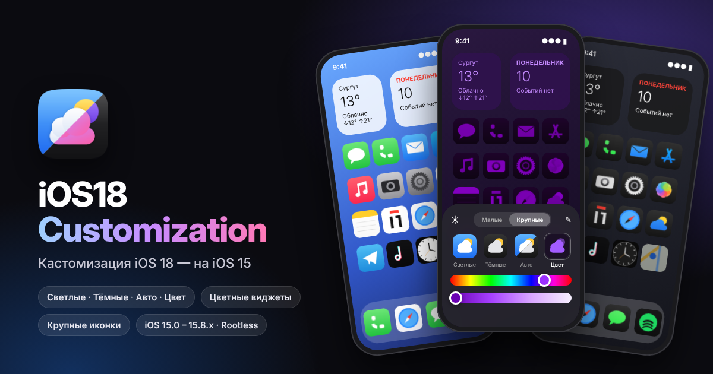

<p align="center">
  
</p>

<h1 align="center">iOS18Customization</h1>

<p align="center">
  Кастомизация домашнего экрана из iOS 18 — на iOS 15.<br>
  Светлые, тёмные, авто и цветные (Tinted) иконки, цветные виджеты, крупные иконки без подписей.
</p>

<p align="center">
  
  
  
  
</p>

---

## Что умеет

Всё как в iOS 18: зажимаешь пустое место на рабочем столе, жмёшь **«+»** в левом верхнем углу и выбираешь **«Настроить»**. Снизу выезжает маленькая панель — изменения видны сразу, без респринга.

| | |
|---|---|
| **Светлые** | обычные иконки, как в стоке |
| **Тёмные** | тёмный фон иконки, цветной значок — как тёмные иконки iOS 18 |
| **Авто** | светлые днём, тёмные при тёмном оформлении системы (переключаются сами) |
| **Цвет** | все иконки, папки, бейджи и виджеты окрашиваются в один цвет |
| **Малые / Крупные** | два «квадрата» вверху панели: крупные иконки без подписей или обычные с подписями |
| **Ползунки** | первый — оттенок, второй — от насыщенного цвета до почти белого |
| **Пипетка** | берёт цвет прямо с обоев (появляется в режиме «Цвет») |
| **Солнце** | затемняет обои рабочего стола |

Пункт **«Добавить виджет»** в том же меню открывает стоковую галерею виджетов, как раньше.

Подробности:

- Окрашиваются иконки на рабочем столе, в доке, в папках и в библиотеке приложений, часы со стрелками, календарь, бейджи уведомлений.
- Виджеты окрашиваются в режиме «Цвет» (как Tinted в iOS 18).
- Нажатие на иконку и блокировка экрана не сбивают окраску.
- В панели — настоящая иконка «Погоды» с телефона в светлом, тёмном, авто и цветном виде, как в iOS 18.
- Настроек в приложении «Настройки» нет — всё делается с рабочего стола, как в iOS 18.

## Совместимость

- **iOS 15.0 – 15.8.x**, iPhone 6s и новее (arm64 и arm64e)
- **Rootless**: Dopamine, palera1n rootless
- **Rootful**: palera1n rootful, checkra1n и т.п.
- Нужен ElleKit или Substitute / Substrate (ставится вместе с джейлбрейком)

На iOS 16+ пакет не ставится специально — для 16–17 есть оригинальный Homescreen18.

## Установка

1. Открой [Releases](https://github.com/Timoshka69/iOS18Customization/releases) (или вкладку **Actions → последняя сборка → Artifacts**).
2. Скачай нужный файл:
   - `..._rootless_iphoneos-arm64.deb` — **Dopamine** и palera1n rootless;
   - `..._rootful_iphoneos-arm.deb` — rootful джейлбрейки.
3. Открой файл в Sileo / Zebra / Filza → Установить → Respring.

## Как пользоваться

1. Долгое нажатие на пустом месте рабочего стола (иконки начинают дрожать).
2. Нажми **«+»** слева вверху → **«Настроить»**.
3. Выбери режим. Для «Цвет» подвигай ползунки или возьми цвет пипеткой с обоев.
4. «Малые / Крупные» — размер иконок. Тап вне панели или свайп вниз — закрыть.

Сбросить всё к стоку: выбрать «Светлые» и «Малые». Или удалить файл
`/var/mobile/Library/Preferences/com.timoshka69.ios18customization.plist` и сделать респринг.

## Сборка

### Через GitHub (ничего ставить не надо)

1. Залей репозиторий к себе на GitHub (название репозитория — `iOS18Customization`, тогда иконка и баннер в Sileo подтянутся сами).
2. Вкладка **Actions** → workflow **Build** запускается сам при каждом push (или вручную: **Run workflow**).
3. Готовые `.deb` лежат в **Artifacts** у сборки.
4. Чтобы получился релиз со скачиваемыми файлами — создай тег:
   ```bash
   git tag v1.0.0
   git push origin v1.0.0
   ```

Workflow: [`.github/workflows/main.yml`](.github/workflows/main.yml) — собирает обе версии (rootless и rootful) на macOS с Theos.

### Локально (Linux / macOS с Theos)

```bash
export THEOS=~/theos
make package FINALPACKAGE=1                          # rootless
make clean package FINALPACKAGE=1 THEOS_PACKAGE_SCHEME=   # rootful
```

Готовый пакет появится в папке `packages/`.

## Как это устроено

Коротко, для тех кому интересно:

- **Тёмные иконки** — у iOS 15 их нет, поэтому твик строит их сам: по краям иконки определяется фон (цвет или градиент), он заменяется тёмным градиентом iOS 18, а сам значок остаётся. Белые значки на цветном фоне (Сообщения, Телефон, App Store) берут цвет фона — как это делает Apple. Сложные картинки (фото, диагональные градиенты) просто затемняются.
- **Цвет (Tinted)** — иконка переводится в оттенки серого с сохранением яркости значка, а цвет накладывается фильтром Core Animation. Поэтому ползунки работают плавно, без пересчёта картинок.
- Стоковые изображения иконок SpringBoard не трогаются — подменяется только то, что показывается на экране. Переключение обратно на «Светлые» мгновенно возвращает сток.
- Все хуки проверяются при запуске: если на какой-то версии 15.x нужного метода нет, отключается только эта функция, SpringBoard не падает.

Исходники: [`Sources/`](Sources)

| Файл | Что внутри |
|---|---|
| `I18ImageFX.m` | обработка пикселей: тёмные иконки, подготовка к Tinted, цветовые матрицы |
| `I18Contents.m` | подмена содержимого слоёв иконок, фильтр цвета |
| `I18HomeScreen.m` | хуки SpringBoard: иконки, бейджи, виджеты, крупный размер |
| `I18EditButton.m` | меню кнопки «+» (Добавить виджет / Настроить) |
| `I18Panel.m`, `I18Controls.m` | панель кастомизации, ползунки, пипетка |
| `I18Wallpaper.m` | затемнение обоев, отслеживание светлой/тёмной темы |
| `I18Settings.m` | настройки и локализация (RU / EN) |

## Если что-то не так

- Иконки не меняются → проверь, что твик включён в ElleKit / Choicy и сделан респринг.
- «+» не открывает меню → открой issue и напиши версию iOS и джейлбрейк (на этот случай слева вверху появляется кнопка «Настроить»).
- Безопасный режим / вылет SpringBoard → удали пакет и открой issue, приложи лог.

## Благодарности

- Apple — за дизайн iOS 18, который здесь повторяется.
- [Homescreen18](https://t.me/evgeniy558) (@evgeniy558, @kirby_swift, @lumid_off) — твик для iOS 16–17, которым вдохновлён этот порт.
- [Theos](https://theos.dev) и [ElleKit](https://github.com/evelyneee/ellekit).

## Лицензия

MIT — см. [LICENSE](LICENSE).

---

### English

iOS 18 home screen customization for **iOS 15.0 – 15.8.x** (rootless and rootful).
Long-press the home screen → **+** → **Customize**: Light / Dark / Automatic / Tinted icons,
tinted widgets and badges, Small / Large icons, eyedropper and wallpaper dimming.
Grab the `.deb` from Releases (`rootless` for Dopamine) or build it with the included GitHub Actions workflow.
